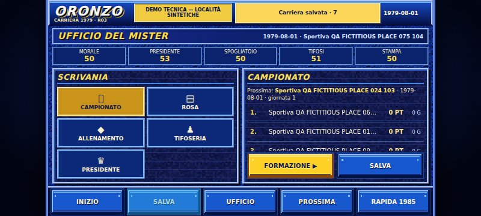
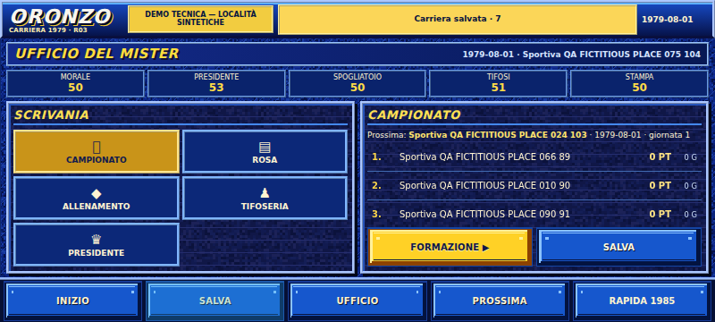
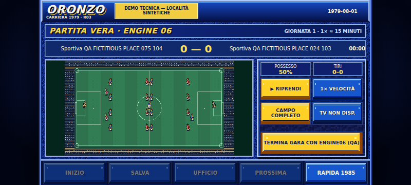
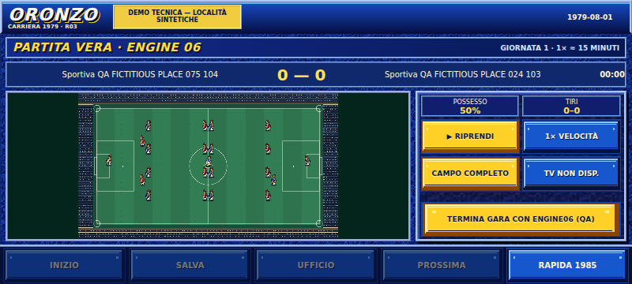
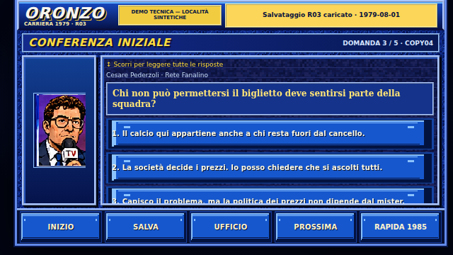
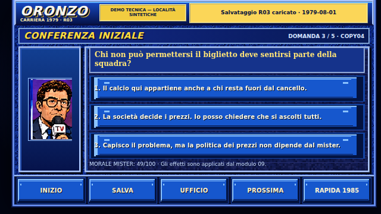

# RAPPORTO ORONZO-AGENT-11 — M01 · Recupero spazio landscape

> **Aggiornamento corrente: R09B-M01-2 consegnato nella stessa PR #48.** Difetto confermato nel gioco HTTP autentico: 39,15625px visibili su44 a640×360 con inset. Pannello conferenza ora esplicitamente scrollabile; **16/16 percorsi, 336/336 risposte ≥44px**, TERMINA GARA44/44 prima e dopo in16 configurazioni, Node97+22 PASS. Commit codice/QA `055f99d0b7ecff51162b8eaa29a3c3f8aea94bb4`. QA autore11, non audit00. Nessun merge. Vedi addendum finale; i blocchi precedenti sono storico.

**Stato: PR_OPEN / richiesta audit 00. Nessun merge.**
PR: [#48](https://github.com/CzekUns/cercax/pull/48).
Data: 8 novembre 2026, Europe/Rome.
Branch: `agent/oronzo-11-mobile-m01`, base ultimo main `55df243b6397d545baab967652f8556f71f878d3`, riconfermato invariato dopo i test.
Commit codice/QA verificato: `c36411d34e880f2caff2a9407e77b41a05055c6d` (questo report segue in commit documentale).
Issue: [#47](https://github.com/CzekUns/cercax/issues/47).

## Continuità e perimetro

Letti integralmente IDENTITY/RUN/NEXT11, PROTOCOL, registry, GAME-VISION-v02, AGENTS e asset-contract, IDENTITY/RUN/NEXT/REPORT03, specifiche 03/11, istruzioni d'integrazione, demo R02, runtime R03, script e risultati QA, API flow07 e renderer05. Ricostruita la storia e discussione delle PR #33/#43, con rapporti indipendenti R07B/R08B: #33 merged `c019d511af89eb54851b3743fba598254d59707f`; #43 merged `241068d383a67c0be8513a2ef9b74b37eea58155`, HEAD approvato `4d00fb5bb6f05465eec30e1b8d997865579d47d8`.

03 è storico/HOLD; nessuna PR UI concorrente rilevata nel controllo delle PR aperte. Identità corrente **11**, nessuna riassegnazione o modifica ai suoi documenti. Non ripartito da zero.

Unico file runtime modificato: **`oronzo/assets/ui/career-r03.css`, otto righe aggiunte**, due regole dentro media query landscape:

- `.site` riserva `env(safe-area-inset-*)` sui quattro lati;
- `#oronzo-r03` usa il 100% della larghezza e altezza del contenitore, già dimensionato con `100dvh`.

Nessun cambiamento HTML, JS, asset, font, altezza delle barre, gameplay, camera, regole, stato o salvataggi. Demo R02 e legacy restano invariati. Aggiunti soltanto QA/script/evidenze locali autorizzate e questo REPORT.
CSS prima: blob `866a60e83b4cce4ca047615ab677dfd99a28c644`; dopo: **`7feecdc8a9e16d01237627c895bf84e8a4586ad5`**. JS runtime sempre `729ab290406d7ab6b33747e6ab09280f04b65af4`, HTML sempre `94b5774f81fefa776108d722af97365e89e78485`.

## Risultato misurato prima/dopo

Chromium **149.0.7827.0**, HTTP locale autentico, DPR 1, desktop e mobile/touch emulato. Numeri CSS px, non misure Android fisico. Le misure sotto valgono per Ufficio e Partita e coincidono tra mouse e touch.

| Viewport innerWidth×innerHeight | Stage prima | Margine per lato prima | Stage dopo | Margini dopo | Superficie occupata prima → dopo |
|---|---|---:|---|---:|---|
| 640×360 | 640×360 | 0 | 640×360 | 0 | 100% → 100% |
| 800×360 | 640×360 | 80 | 800×360 | 0 | 80% → 100% |
| 844×390 | 693,328×390 | 75,328 | 844×390 | 0 | 82,15% → 100% |
| 960×400 | 711,109×400 | 124,438 circa | 960×400 | 0 | 74,07% → 100% |

In assenza di cutout restano **zero px inutilizzati fuori dallo stage**. Su 800×360 lo stage recupera 160 px totali (+25% rispetto alla sua larghezza iniziale); su 844×390 recupera circa 151 px (+21,73%); su 960×400 circa 249 px (+35%). Le larghezze dei pannelli flessibili e dei tasti crescono, senza cambiare font o altezze.

| Viewport | Canvas prima e dopo (larghezza×altezza) | Rapporto misurato dopo |
|---|---|---:|
| 640×360 | 328,875×184,984 | 1,77785 |
| 800×360 | 328,875×184,984 | 1,77785 |
| 844×390 | 361,078×203,094 | 1,77789 |
| 960×400 | 378,859×213,094 | 1,77790 |

**Il campo non diventa più grande in M01:** è già limitato dall'altezza disponibile. Il canvas 640×360 conserva scala uniforme e intero campo. Rimane spazio verde interno ai lati del canvas: è il contenimento intenzionale del campo 16:9, non una nuova camera o una superficie occupata dal campo stesso. Riempirlo richiederebbe sacrificare altezza delle barre/controlli o cambiare camera, fuori mandato. Nessuna promessa di aumento del campo o di zoom.

## Verifiche realmente eseguite

| Controllo | Esito |
|---|---|
| Node flow/carriera/coach sul branch con CSS definitivo | **97/97 PASS**, 0 fail; circa 18,8 s |
| Node renderer05 | **22/22 PASS**, 0 fail |
| `node --check career-r03.js` | PASS |
| `python qa/check_assets.py` | PASS, 10 PNG originali e manifest |
| Chromium prima / dopo | **8/8 + 8/8 PASS**, quattro viewport × mouse/touch |
| Clic e touch | Coordinate centrali con hit test, senza auto-scroll delle CTA; swipe CDP e wheel per raggiungere ultime righe |
| Touch target misurati dopo | Minimo **44 px realmente visibili**, larghezza minima 70,5 px sui target campionati; clipping calcolato lungo tutti gli antenati overflow |
| Toast/header/footer/banner | Zero intersezioni toast/controlli/indicatori; banner visibile, nessuna riduzione font; ispezione screenshot nativi |
| Safe area CDP simulata | A 844×390 con sinistra24/destra12/basso16: stage x24/y0, **808×374**, CTA fisse e partita interamente raggiungibili; canvas 332,625×187,094, rapporto preservato |
| Resize viewport (simulazione toolbar) | 844×360 → 844×390 → 960×400: stage segue esattamente lo spazio disponibile; controlli fissi verificati |
| Orientamento | Avviso portrait e ritorno landscape riusciti in tutti gli 8 percorsi dopo |
| Kit R02 separato | Conserva 16:9 e margini: a 960×400 stage 711,109×400 |
| Link legacy / Rapida 1985 | Collegamenti presenti e pagina partita rapida HTTP 200; nessun file legacy cambiato |
| Integrità sorgenti ricostruiti | **246/246 blob invariati** corrispondenti al main, oltre al CSS letto prima della modifica; manifest SHA in QA |

Ogni percorso browser esercita il **runtime reale**: otto avatar selezionati, 20 offerte dal controller07 e ultima raggiunta con gesto, ingaggio/presidente, cinque risposte iniziali, Ufficio, Rosa e Allenamento con 16/16 e scheda dell'ultimo, classifica 16/16 e scroll finale, formazione 11/GK/capitano, 22 attori Engine06 e fulltime tramite comando QA reale, due domande postpartita, avanzamento a settimana2, reload HTTP e caricamento JSON identico. Provati game over tramite API09, nuova carriera senza cancellazione dei save, rifiuto del dialogo di sovrascrittura, e `geography_required` senza mutazione. Nessuna simulazione o storage sostituiti nel test.

**Zero eccezioni JavaScript** nel percorso R03. Rimane il noto **404 opzionale `assets/cutscenes/manifest.json`** per partita, già assente da main; nessun altro HTTP >=400 rilevato. Non dichiaro console di rete senza errori.

## Evidenze e replica

- `oronzo/assets/ui/qa/m01-landscape.cjs`: server HTTP e confronto funzionale/metrico;
- `oronzo/assets/ui/qa/m01-environment.cjs`: safe area, resize, target fissi e collegamenti legacy;
- `oronzo/assets/ui/qa/m01/`: **48 screenshot Chromium nativi** (6 viste × 4 viewport × prima/dopo), `before-results.json`, `after-results.json`, `environment-results.json`, log Node/browser, SHA sorgenti e README con comandi.

Confronto principale 800×360:

| Ufficio prima | Ufficio dopo |
|---|---|
|  |  |

| Partita prima | Partita dopo |
|---|---|
|  |  |

Gli altri screenshot includono Avatar, Offerte, Conferenza e Classifica alle quattro risoluzioni. Metriche complete (inclusi coordinate e rapporto del canvas) nei JSON. Gli script Python storici R03/R04/R07/R08 sono stati letti, non rieseguiti come comandi: questo ciclo usa i nuovi harness Node HTTP senza route.fulfill o storage shim.

## Limiti e prova Android

**Non testato Android fisico, non pubblicata una preview di questo branch, non attesi 900 secondi reali di gara.** Cutout e resize sono emulazioni, non la prova delle barre di Chrome/gesture Android reali. Conservati testi piccoli esistenti, da valutare sul telefono; nessun giudizio di leggibilità fisica universale. Non certificata una nuova suite completa di gameplay legacy.

Per provare prima del merge: checkout del branch, `python3 -m http.server 8000 --bind 0.0.0.0` dalla root; Android sulla stessa rete, aprire `http://<IP-LAN-del-PC>:8000/oronzo/assets/ui/career-r03.html`, ruotare landscape, confrontare Ufficio/Partita con barre visibili e nascoste, tornare portrait/landscape e ricaricare il save. IP/URL LAN non verificati qui. Usare deliberatamente la modalità etichettata sintetica. Il sito pubblico continua a servire main finché non viene effettuato un merge autorizzato.

## Handoff

M01 consegnato per **audit mobile CSS dell'Agente00** e coordinamento dell'Agente10. Nessun merge e nessun incarico assegnato ad altri agenti. API/contratti invariati; non serve integrare moduli nuovi.

M02 camera segue pallone, M03 comandi mister e M04 **Layout Studio privato dello sviluppatore** restano futuri NEXT separati. Nessun editor, link o codice Layout Studio nell'app per giocatori. Prossimo passo consigliato: audit00 e prova Android reale; nessuna estensione autonoma del mandato.

---

## Addendum — Correzione R09-M01-1 · 8 novembre 2026

**Stato: FIX_DELIVERED / PR_OPEN, richiesta gate R09B in chat separata.** Stessa PR [#48](https://github.com/CzekUns/cercax/pull/48), stesso branch `agent/oronzo-11-mobile-m01`; nessuna nuova PR e nessun merge. Letto il NEXT11 `FIX_REQUESTED` dall'ultimo main `7476ea1e50f19335643b6ae3cf58cb93cb1ebc8d` e il [REPORT-R09-M01](https://github.com/CzekUns/cercax/blob/audit/oronzo-coerentizzatore-r09-m01/oronzo/coordination/coerentizzatore/REPORT-R09-M01.md). HEAD iniziale #48 `6e72486607405d06d9a5ba8cac8d00a002ea5da8`.

### Modifica minima realizzata

In `career-r03.css`, dentro la media query landscape già esistente, aggiunta una sola dichiarazione:

```css
#oronzo-r03 .runtime-match-panel{padding-top:1px}
```

Si recuperano **2px dal padding decorativo superiore** del pannello compatto (3→1px), e spazio sufficiente anche nella configurazione a viewport400px. Il bottone mantiene la propria altezza44px; non viene scalato. Nessuna riduzione di font, nessuna rimozione degli inset, nessun cambiamento alle dimensioni dello stage o del canvas. CSS prima blob `7feecdc8a9e16d01237627c895bf84e8a4586ad5`; dopo **`e9a9a1194bee8051755220650481538f6ef19e15`**.

**Unico file runtime modificato rispetto all'HEAD iniziale: career-r03.css, due righe aggiunte (commento + regola).** Altri file: QA locale autorizzata e questo REPORT. Nessun HTML/JS di gameplay, flow, renderer, engine, copia, dati o salvataggi modificato. Verificati **307 file locali preesistenti identici ai blob dell'HEAD iniziale**, esclusi soltanto il CSS modificato e i nuovi file QA. Non modificati i NEXT.

### Matrice del pulsante TERMINA GARA

Intersezione del rettangolo con viewport e **aree interne di tutti gli antenati overflow**, hit-test `elementFromPoint`, mouse.click/touchscreen.tap alle coordinate centrali senza autoscroll della CTA. Insets via CDP `{top:0,left:24,right:12,bottom:16}`.

| Viewport | Senza inset, prima → dopo | Con inset, prima → dopo | Mouse/touch sul fix |
|---|---|---|---|
| 640×360 | 44 → **44px** | 42 → **44px** | PASS / PASS |
| 800×360 | 44 → **44px** | 42 → **44px** | PASS / PASS |
| 844×390 | 44 → **44px** | 44 → **44px** | PASS / PASS |
| 960×400 | 44 → **44px** | 42 → **44px** | PASS / PASS |

**16/16 misure positive**, nominale44/visibile44, centro corretto e completamento reale Engine06 fino a `postmatch_press`. Controllo supplementare del solo pannello: 8/8 con inset, tutti i quattro comandi e TERMINA GARA conservano44px visibili.

Con inset lo stage misura **604×344**, **764×344**, **808×374**, **924×384**, x24/y0. Senza inset occupa esattamente i quattro viewport. Canvas con inset rispettivamente **300,4375×168,9844**, **300,4375×168,9844**, **332,625×187,0938**, **350,4063×197,0938**; rapporto sempre16:9 entro arrotondamento subpixel. Nessun aumento di zoom o deformazione. Senza inset i canvas sono identici alle misure M01 precedenti.

### Test realmente rieseguiti sul fix

| Verifica | Risultato |
|---|---|
| Node flow/carriera/coach | **97/97 PASS**, 0 fail, circa19,4s |
| Node renderer | **22/22 PASS**, 0 fail |
| Nuovo harness Chromium HTTP/storage autentici | **16 percorsi funzionali completati**, 4 viewport × 2 inset × 2 modalità input |
| Obiettivo R09-M01-1 | **16/16 PASS**, 44px effettivi e tap centrale funzionante |
| Confronto font calcolati nelle viste | Identici con/senza inset; CSS del fix non modifica font o target |
| Orientamento e ritorno landscape | Verificati nei16 percorsi |
| Save/reload, game over e geography_required | Verificati nei16 percorsi |

Ambiente: **Chromium153.0.8010.0**, DPR1, locale it-IT, HTTP locale vero, ESM/JSON/PNG originali, localStorage autentico; nessun route.fulfill/set_content/shim. Ogni percorso comprende gli8 avatar, 20 offerte con ultima raggiunta via gesture/wheel, ingaggio/presidente, 5 risposte iniziali, Ufficio, Rosa16 e scheda del sedicesimo confrontata con API07, allenamento consultivo senza mutazioni, classifica16 confrontata con API e scroll finale, 11 titolari/1GK/capitano, 22 attori Engine06/fulltime, 2 risposte finali, avanzamento a settimana2, reload e JSON identico dopo caricamento. Verificati morale0 tramite API09, nuova carriera con salvataggio precedente preservato e dialogo di sovrascrittura rifiutato; `geography_required` senza mutazione.

Zero eccezioni JS nei percorsi; rimane il **404 opzionale cutscene/manifest.json** già presente. Android fisico, preview pubblica e900s continuativi non verificati. Questi sono test dell'autore11, **non audit indipendente00**.

### Altra osservazione preesistente, non corretta in questo incarico

**Non dichiaro PASS generale di tutte le geometrie con inset.** Nel test più esteso, a640×360 con safe area, avatar1 e ultima offerta, la terza risposta della domanda iniziale3 («Capisco il problema, ma la politica dei prezzi non dipende dal mister.») misura **39,15625px visibili su44px nominali**, y247,84375. Rilevata sia mouse sia touch; nessun altro rilievo raccolto nella matrice. Il percorso funzionale prosegue usando una risposta pienamente raggiungibile.

Un confronto HTTP aggiuntivo con il **CSS precedente dell'HEAD6e724866** conferma **stessi testo, y, altezza e clipping prima e dopo questo fix**. È una condizione della conferenza preesistente, non causata dalla modifica al padding del pannello partita. Nessuna regola della stampa è stata modificata: il mandato autorizza esclusivamente R09-M01-1. Il QA conserva il rilievo in `otherFindings` e stato `R09_FIX_PASS_WITH_OTHER_FINDINGS` nei2 casi interessati, invece di nasconderlo. L'orchestratore/revisore dovrà considerarlo per l'eventuale incarico successivo.

### Evidenze e consegna

- `oronzo/assets/ui/qa/m01-fix-r09.cjs`: matrice completa riproducibile da root, HTTP, gesture e geometria effettiva;
- `oronzo/assets/ui/qa/m01-r09-fix/results.json`: tutte16 le esecuzioni e le osservazioni separate; il controllo finish-qa rimane bloccante;
- `target-probe.json`, `before-safe-results.json`, `existing-press-before-after.json`, log Node e browser, README;
- **32 PNG selezionati:** Partita in tutte16 le combinazioni, Avatar e Ufficio negli8 casi con inset. Le altre viste sono state misurate e possono essere rigenerate col comando nel README.

Commit codice/QA **`efd42f14ef7c6c9949d2bfe936a64e04d4b6a47e`**; questo aggiornamento REPORT segue in commit documentale. Ripresentata soltanto la PR48. Atteso **R09B-M01 in chat separata**; nessun auto-merge, nessuna telecamera, comando allenatore o Layout Studio avviato.


---

## Addendum — Recupero sessione e R09B-M01-2 · 8 novembre 2026

**Stato: FIX_DELIVERED / PR_OPEN / NO MERGE.** Stessa [PR #48](https://github.com/CzekUns/cercax/pull/48), branch `agent/oronzo-11-mobile-m01`.
**Commit codice/QA verificato:** `055f99d0b7ecff51162b8eaa29a3c3f8aea94bb4`. Questo REPORT segue in commit documentale.
**HEAD pubblicato da cui si è ripartiti:** `58c7c65506f74f012b17b099583e96ee380f8db5`.

### Recupero e origine del difetto

Riletti da main i documenti11 e il NEXT `FIX_REQUESTED` R09B-M01-2, con coordinamento/handoff03 e rapporti R07B/R08B; main recuperato `7ff82d52c9d00a8cc224f55c743037bdc0d98319`. Riletti REPORT11 dal branch della PR e REPORT-R09B-M01 dal branch `audit/oronzo-coerentizzatore-r09b-m01-20261108`. PR48 riconfermata OPEN/NOT MERGED e HEAD invariato prima della pubblicazione. Nessuna PR UI produttiva concorrente rilevata.

Il checkout parte dal repository, non dal presunto completamento della vecchia chat. Individuate anche bozze QA/CSS non pubblicate nella vecchia area temporanea: riutilizzate come materiale da riesaminare, **senza attribuire loro alcun test completato**. Tutte le prove qui dichiarate sono state rieseguite sul nuovo checkout dal HEAD GitHub noto.

**Chromium153.0.8010.0, HTTP locale, DOM/ESM/JSON/PNG e localStorage autentici**, DPR1, locale it-IT, Node24.22.1. Nessuna fixture del layout, `route.fulfill`, `set_content` o storage shim. Browser estratto dal pacchetto Chromium già disponibile dopo fallimento del download standard; nessun blocco HTTP nella prova effettiva.

Confronto a640×360, avatar1, ventesima offerta, domanda iniziale3, terza risposta («Capisco il problema, ma la politica dei prezzi non dipende dal mister.»), safe area `{top:0,left:24,right:12,bottom:16}`; stessi risultati mouse/touch:

| CSS effettivamente servito via HTTP | Stage | Altezza nominale | Altezza visibile |
|---|---|---:|---:|
| Prima di M01, base55df243 | 640×360, x0/y0 | 44,625 | 44,625 |
| HEAD58c7c65 prima del fix conferenza | 604×344, x24/y0 | 44 | **39,15625** |
| Fix conferenza, risposta raggiunta con wheel/swipe | 604×344, x24/y0 | 44 | **44** |

**Rettifica della formulazione storica “preesistente”:** il difetto era precedente al solo fix TERMINA GARA, ma **non è riprodotto prima di M01** in questo scenario. La riserva safe area M01 riduce lo spazio disponibile e fa emergere il clipping della `.panel.runtime-answers` con `overflow:hidden`. Il confronto con base55df243 preserva tutto il gioco e sostituisce soltanto il CSS con il blob originale `866a60e83b4cce4ca047615ab677dfd99a28c644`; non è una ricostruzione della UI. `origin-results.json` contiene per entrambe le revisioni tutta la catena degli antenati e le geometrie, oltre al confronto dopo fix.

### Modifica minima nello scope autorizzato

**Unico file runtime cambiato: `oronzo/assets/ui/career-r03.css`, sette righe aggiunte.** Quattro regole limitate a `#oronzo-r03 .runtime-answers`:

- pannello scorrevole verticalmente, gesture pan-y, scrollbar oro e spazio scrollbar stabile;
- figli non comprimibili e risposte con minimo44px, altezza libera per il testo completo;
- interruzione delle parole lunghe senza ridurre caratteri o contenuti;
- indicazione iniziale «↕ Scorri per leggere tutte le risposte».

Quando necessario si scorre **il solo pannello conferenza**, poi ogni risposta è interamente visibile e attivabile. La navigazione resta fuori dal suo scroll. Font e testi originali sono invariati; nessun cambiamento HTML/JS di gioco, flow, renderer, engine, salvataggi o dati. Safe area, larghezza piena e correzione TERMINA GARA conservate. Il manifest `source-integrity.json` confronta177 file runtime preesistenti: **176 identici e solo il CSS previsto diverso**.

### Risultati freschi, non ereditati dalla sessione bloccata

| Verifica | Risultato osservato |
|---|---|
| Chromium HTTP completo,4 viewport ×2 inset ×2 input | **16/16 PASS** |
| Tutte3 le opzioni ×5 domande iniziali ×16 casi | **240/240 PASS** |
| Tutte3 le opzioni ×2 domande postpartita ×16 casi | **96/96 PASS** |
| Minimo delle336 risposte al momento dell'interazione | **44px visibili**, larghezza minima453px; intero rettangolo visibile e hit centrale positivo |
| TERMINA GARA prima/dopo fix conferenza | **44→44px in16/16 coppie**; tap/clic porta realmente a postmatch_press |
| Font domanda/risposte e geometria stage/canvas prima/dopo | **Identici in16/16 coppie**; font con/senza inset identici anche nel percorso completo |
| Node flow/carriera/coach | **97/97 PASS**,0 fail,18,26s |
| Node renderer05 | **22/22 PASS**,0 fail |
| Sintassi dei3 nuovi harness e git diff --check | **PASS** |

Viewport640×360,800×360,844×390,960×400; inset assenti oppure top0/left24/right12/bottom16, mouse e touch emulato. La geometria viene intersecata con viewport e area interna di **tutti** gli antenati overflow. Le opzioni si attivano con mouse.click/touchscreen.tap sul centro misurato, senza auto-scroll dei locator. Scorrimento della conferenza tramite wheel/gesture CDP reale. Per provare ciascuna alternativa si ripristina il precedente salvataggio nel vero localStorage e si usa CARICA del gioco: JSON completo identico prima del nuovo tentativo. Nessuna modifica dello stato tramite un falso handler di risposta.

Tutti16 i percorsi includono8 avatar,20 offerte e ultima raggiunta con gesto, ingaggio/presidente,5 domande, Ufficio, Rosa16 con scheda del sedicesimo e API07, Allenamento in lettura senza mutazione, classifica16 confrontata con API e scroll finale,11 titolari/1GK,22 attori Engine06/fulltime reale tramite comando QA,2 domande finali, avanzamento a settimana2, save/reload/load identico, morale0 con API09/gameover, nuova carriera con vecchio save protetto e sovrascrittura rifiutata, geography_required senza mutazione, portrait/landscape.

Zero pageerror nei16 percorsi. Rimane il **404 opzionale del manifest cutscene assente**, nessun altro HTTP>=400 rilevato. Lo scroll può lasciare inizialmente una risposta fuori vista: l'indicazione esplicita e il gesto la rendono completamente raggiungibile; non si dichiara che tutte le risposte siano sempre visibili contemporaneamente.

### Evidenze, replica e prossimo gate

Dentro `oronzo/assets/ui/qa/`: `m01-press-origin.cjs`, `m01-press-compare.cjs`, `m01-press-runtime.cjs`; sottocartella `m01-press-r09b/` con README/comandi, snapshot CSS Git, risultati origine/confronto/matrice, riepilogo, manifest integrità, log Node/browser e **50 screenshot Chromium nativi** selezionati. Misurati tutti i casi, anche quando la relativa schermata non è tra i PNG selezionati; gli harness possono rigenerarli tutti.

Esempio640×360 touch con inset:

| Inizio domanda3, indicazione di scorrimento | Dopo gesto, terza risposta completa |
|---|---|
|  |  |

**Limiti:** QA dell'autore11, non nuova verifica indipendente00. Android fisico, preview pubblica,900 secondi continuativi a1× e intera carriera nel browser non verificati. Nessuna camera nuova, comando allenatore o Layout Studio. Il sito pubblico non è stato modificato.

Checkout reale usato in questa sessione: `/workspace/scratch/c9a778bd01f3/repo`; il revisore deve verificare l'accesso al preciso nuovo HEAD e rieseguire Chromium HTTP sul gioco autentico. Il README è riproducibile anche su altro checkout; la fixture del precedente audit non può sostituire questo gate. **PR48 resta aperta: nessun merge e nessun incarico assegnato ad altri agenti.**
